<picture>
  <source media="(prefers-color-scheme: dark)" srcset="assets/profile-dark.svg" />
  <source media="(prefers-color-scheme: light)" srcset="assets/profile-light.svg" />
  
</picture>

**AI & Full Stack Engineer** · Navi Mumbai, India

I build web applications, backend services, and AI integrations with Node.js and TypeScript. My work spans workshop software, conversational workflows, and enterprise API integrations.

[LinkedIn](https://www.linkedin.com/in/pratik-sawant-b82782214) · [Email](mailto:pratiksawant542@gmail.com) · [Portfolio repository](https://github.com/Pratiksawan/Pratik-portfolio)

---

## Selected work

### MotoDock
Workshop management software for job cards, inventory, estimates, and billing, with AI-assisted diagnostics. Engineering focus: tenant isolation, role-based access, and transaction-safe workflows.

**Node.js · TypeScript · React · Prisma · PostgreSQL · Gemini**  
[Case study](docs/selected-work.md#motodock)

### WhatsApp Business Chatbot Platform
Conversational workflows built around dynamic Meta Flows, API integrations, and webhooks. Engineering focus: conversation state, input validation, and recovery from upstream failures.

**Node.js · Express · Meta WhatsApp Cloud API · MySQL · Redis**  
[Case study](docs/selected-work.md#whatsapp-business-chatbot-platform)

### Personal portfolio
A Next.js portfolio presenting my work through project case studies and interactive engineering exhibits, including an illustrative diagnostic simulator.

**Next.js · React · TypeScript · Tailwind CSS · Framer Motion**  
[Source code & setup](https://github.com/Pratiksawan/Pratik-portfolio)

## Technical focus

| Area | Technologies |
| --- | --- |
| Backend | Node.js, TypeScript, Express, REST APIs, webhooks |
| Frontend | React, Next.js, Tailwind CSS |
| Data | PostgreSQL, Redis, Prisma |
| AI & delivery | Gemini API, ChatGPT API, Docker |

## Engineering interests

Validation and fallback handling around AI outputs, reliable API integrations, and data isolation in multi-tenant systems.

Contribution activity

<picture>
  <source media="(prefers-color-scheme: dark)" srcset="https://raw.githubusercontent.com/Pratiksawan/Pratiksawan/output/github-snake-dark.svg" />
  <source media="(prefers-color-scheme: light)" srcset="https://raw.githubusercontent.com/Pratiksawan/Pratiksawan/output/github-snake.svg" />
  
</picture>

[View activity on GitHub](https://github.com/Pratiksawan?tab=overview)

