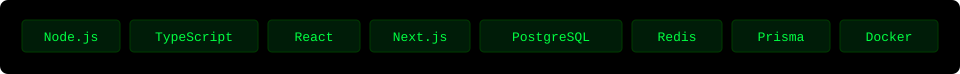

<div align="center">





[LinkedIn](https://www.linkedin.com/in/pratik-sawant-b82782214) · [Email](mailto:pratiksawant542@gmail.com) · [Portfolio source](https://github.com/Pratiksawan/Pratik-portfolio)

</div>

## / boot

<div align="center">

</div>

## / choose your path

<div align="center">


[Explore my work](docs/selected-work.md) · [Browse public repositories](https://github.com/Pratiksawan?tab=repositories)
</div>

## / operator

```text
name      : Pratik Sawant
role      : AI & Full Stack Engineer
location  : Navi Mumbai, India
builds    : web applications, backend services, AI integrations
focus     : validation, reliable APIs, multi-tenant data isolation

"There is no spoon."
```

I build with Node.js and TypeScript across workshop software, conversational workflows, and enterprise API integrations.

## / stack

<div align="center">

</div>

**Also:** Express, REST APIs, webhooks, Tailwind CSS, Gemini API and ChatGPT API.

## / selected work

**[MotoDock — workshop ERP](docs/selected-work.md#motodock)**  
Job cards, inventory, estimates and billing with AI-assisted diagnostics, tenant isolation and role-based access.  
`Node.js` `TypeScript` `React` `Prisma` `PostgreSQL` `Gemini`

**[WhatsApp Business Chatbot Platform](docs/selected-work.md#whatsapp-business-chatbot-platform)**  
Dynamic Meta Flows, conversational state, API integrations and recovery from upstream failures.  
`Node.js` `Express` `WhatsApp Cloud API` `MySQL` `Redis`

**[Personal portfolio — source & setup](https://github.com/Pratiksawan/Pratik-portfolio)**  
Project case studies and interactive engineering exhibits, including a diagnostic simulator with predefined sample data.  
`Next.js` `React` `TypeScript` `Tailwind CSS` `Framer Motion`

MotoDock and chatbot links are case studies. Their complete application source is not linked publicly.

## / telemetry

<details>
<summary>Open GitHub stats, streak and language cards</summary>

<div align="center">




</div>

If a free card service is unavailable or rate-limited, use [GitHub activity](https://github.com/Pratiksawan?tab=overview) and [public repositories](https://github.com/Pratiksawan?tab=repositories). Language cards describe indexed public code, not proficiency.

</details>

## / contribution stream

<div align="center">

<picture>
  <source media="(prefers-color-scheme: dark)" srcset="https://raw.githubusercontent.com/Pratiksawan/Pratiksawan/output/github-snake-dark.svg" />
  <source media="(prefers-color-scheme: light)" srcset="https://raw.githubusercontent.com/Pratiksawan/Pratiksawan/output/github-snake.svg" />
  
</picture>

</div>

---

<div align="center">

`There is no spoon.`

[LinkedIn](https://www.linkedin.com/in/pratik-sawant-b82782214) · [Email](mailto:pratiksawant542@gmail.com) · [GitHub](https://github.com/Pratiksawan)

<sub>Original cinematic SVGs. No JavaScript, movie images, logos or characters.</sub>

</div>
